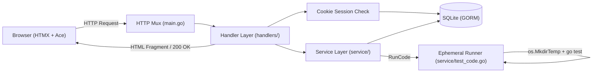

# AI Agent & Developer Operating Guide: Go-Solve

Welcome to **`go-solve`**! This document serves as the single source of truth for onboarding human developers and AI coding agents. It details the project architecture, operational conventions, development workflow, security guardrails, and automated pipelines.

---

## 1. Project Overview & Architecture

### What is Go-Solve?
`go-solve` is an open-source, web-based programming practice platform for the Go language (inspired by CodingBat). Learners solve algorithmic challenges ("tasks") directly in an in-browser code editor (Ace Editor), run their code against test suites in real-time using HTMX, and track their progress across difficulty tiers.

### Technical Stack
- **Language & Runtime:** Go 1.24+ (Toolchain Go 1.24.1)
- **Web Layer:** Go Standard Library `net/http` + HTML Templates (`html/template`)
- **Frontend Interactivity:** [HTMX](https://htmx.org/) (AJAX swaps without complex client-side frameworks)
- **Styling:** Tailwind CSS (Dark theme)
- **Code Editor:** [Ace Editor](https://ace.c9.io/) with Go syntax highlighting
- **ORM & Database:** [GORM](https://gorm.io/) with SQLite driver (`github.com/mattn/go-sqlite3`)
- **Password Security:** `golang.org/x/crypto/bcrypt` (cost 14)
- **Deployment:** Docker & [Fly.io](https://fly.io)

### Architectural Flow


---

## 2. Repository Layout

```
.
├── .github/
│   └── workflows/go.yml     # GitHub Actions CI workflow
├── data/                    # Local SQLite databases (gitignored)
├── db/
│   ├── db.go                # DB connection, AutoMigrate, and CRUD helpers
│   ├── db_test.go           # Unit tests running against in-memory SQLite (:memory:)
│   └── seed.go              # Idempotent default task seeder (Hello World, Bubbles)
├── handlers/
│   ├── handlers.go          # Standard http.HandlerFunc implementations
│   └── handlers_test.go     # HTTP integration and multi-user isolation tests
├── model/
│   ├── session.go           # Session model (token, user_id, expires_at)
│   ├── task.go              # Task and TaskResult models
│   ├── task_progress.go     # User-Task progress tracking model
│   └── user.go              # User model with bcrypt password hash
├── security/
│   ├── hash.go              # Bcrypt password hashing and verification
│   └── hash_test.go         # Password hash unit tests
├── service/
│   ├── service.go           # User, session, and progress domain logic
│   ├── test_code.go         # Ephemeral code execution runner with timeout
│   └── test_code_test.go    # Test runner verification (pass, fail, syntax, timeout)
├── static/                  # Static assets (favicons, images)
├── tasks/                   # Problem catalog test suites & reference solutions
│   └── easy/
│       ├── bubbles/         # Bubble sort task
│       └── hello_world/     # Hello World task
├── templates/               # Server-rendered HTML templates
├── Dockerfile               # Production Docker container configuration
├── fly.toml                 # Fly.io deployment manifest
├── go.mod / go.sum          # Go dependencies
├── ISSUES.md                # Comprehensive issue catalog and revival roadmap
└── main.go                  # Application entrypoint & HTTP server bootstrap
```

---

## 3. Core System Mechanics

### 3.1. Session Authentication & Concurrency
- **Zero Global User State:** Requests extract the authenticated user via `handlers.GetUserFromRequest(r)`.
- **Session Tokens:** Cryptographically random 32-byte hex tokens (`crypto/rand`) stored in the SQLite `session` table with a 30-day expiration.
- **Client Storage:** Delivered via an HTTP-only, `SameSite=Lax`, path-scoped cookie (`session_token`).
- **Anonymous Execution:** Unauthenticated visitors can practice solving problems without logging in. Progress persistence is conditionally enabled for authenticated sessions (`user.ID > 0`).
- **Safe Logout:** `LogoutHandler` deletes the session from the database, expires the client cookie (`MaxAge: -1`), and redirects using **HTTP 303 `StatusSeeOther`** to prevent browser redirect caching.

### 3.2. Code Evaluation Runner (`service/test_code.go`)
- **Isolation:** Every code submission runs inside an ephemeral temporary directory generated with `os.MkdirTemp("", "gosolve-eval-*")`.
- **Environment:** The runner writes an isolated `go.mod`, copies only the task's `*_test.go` files, writes the user's solution to `solution.go`, and executes `go test -v .`.
- **Guaranteed Cleanup:** `defer os.RemoveAll(tmpDir)` ensures zero persistent files on the host disk and prevents Git working tree contamination.
- **Execution Timeout:** Enforced via `context.WithTimeout(ctx, 5*time.Second)` to terminate infinite loops (`for {}`) or blocking system calls.
- **Starter Code Immutability:** Handlers clone the task struct prior to evaluation (`evalTask := *task; evalTask.Code = editorContent`), guaranteeing that in-memory starter code is never mutated.

### 3.3. Database Initialization & Seeding
- **Path Configuration:** Configurable via `DATABASE_PATH` environment variable (defaults to `./data/go-solve.db`).
- **Auto-Migration:** On server boot, `db.AutoMigrate` runs automatically for `User`, `Task`, `TaskProgress`, and `Session`.
- **Task Seeding:** `db.SeedTasks` automatically seeds default tasks ("Hello World", "Bubbles") if the `task` table is empty.

---

## 4. Development Workflow

### Prerequisites
- Go 1.24+ installed (`go version`)
- Git

### Quickstart
```sh
# 1. Clone repository
git clone https://github.com/Carter907/go-solve.git
cd go-solve

# 2. Run the server (auto-creates DB, runs migrations & seeds tasks)
go run main.go

# 3. Access in browser
open http://localhost:8080
```

### Running Tests
Always run the full test suite before committing:
```sh
# Run all tests without cache
go test -v -count=1 ./...

# Run tests with race detector
go test -race ./...
```

---

## 5. Agent & Developer Guardrails

When modifying or extending this codebase, **adhere strictly to the following rules**:

| Rule | Rationale |
| :--- | :--- |
| **Never introduce global request state** | Global pointers (like previous `user *model.User` in `main.go`) cause catastrophic cross-user request bleed and data races. Always pass request context or extract via session cookies. |
| **Never write test code directly to `tasks/` on host** | User evaluation must always occur inside ephemeral `os.MkdirTemp` runners with `defer os.RemoveAll`. Never overwrite files in the repository tree. |
| **Never call `log.Fatal` / `log.Fatalln` in request paths** | Calling `log.Fatal` triggers `os.Exit(1)`, killing the entire web server on transient errors. Return standard Go errors and render HTTP 500 / 400 responses. |
| **Never print passwords or credentials to stdout** | Do not log plaintext passwords or hashes (`fmt.Println`) in handlers or services. User passwords must remain confidential. |
| **Maintain reference solutions in `tasks/`** | Every task in `tasks/<difficulty>/<task>/` must include a valid reference implementation (`<task>.go`) alongside its test suite so that `go test ./...` in CI is permanently green. |
| **Follow Conventional Commits** | Commits must use standard prefixes: `feat:`, `fix:`, `docs:`, `refactor:`, `test:`, `chore:`. |

---

## 6. How to Add a New Task

To add a new programming challenge to `go-solve`:

### Step 1: Create the Task Package
Create a folder under `tasks/<difficulty>/<task_slug>/`:
```sh
mkdir -p tasks/easy/sum_two
```

### Step 2: Implement the Grader Test Suite
Create `tasks/easy/sum_two/sum_two_test.go`:
```go
package sum_two

import "testing"

func TestSumTwo(t *testing.T) {
	if got := SumTwo(2, 3); got != 5 {
		t.Fatalf("SumTwo(2, 3) = %d; want 5", got)
	}
}
```

### Step 3: Implement the Reference Solution
Create `tasks/easy/sum_two/sum_two.go`:
```go
package sum_two

// SumTwo returns the sum of two integers.
func SumTwo(a, b int) int {
	return a + b
}
```

### Step 4: Register in `db/seed.go`
Add the task definition and starter stub to `defaultTasks` in [`db/seed.go`](file:///home/speer/Code/golang/go-solve/db/seed.go):
```go
{
    Title:       "Sum Two",
    Description: "Return the sum of two integers",
    Difficulty:  "easy",
    Objective:   "Write a function that returns the sum of a and b.",
    Code: `package sum_two

func SumTwo(a, b int) int {

}
`,
}
```

### Step 5: Verify
```sh
go test -v ./tasks/easy/sum_two
go test -v ./...
```

---

## 7. Active Roadmap & Revival Status

Consult [`ISSUES.md`](file:///home/speer/Code/golang/go-solve/ISSUES.md) for the active backlog and priority matrix.

- [x] **Phase 1: Stabilization & Fix CI** (Repaired test suite, reference solutions, runner timeout, AutoMigrate & seeder, untracked `data/db`).
- [x] **Phase 2: Concurrency & Sessions** (Cookie session management, eliminated global `user` and `currTaskIndex`, task ID routing, starter code immutability).
- [ ] **Phase 3: Secure Runner Sandboxing** (Containerized execution with dropped capabilities / gVisor / nsjail to prevent arbitrary host RCE).
- [ ] **Phase 4: Routing & Performance Polish** (Go 1.22+ mux routing, template pre-parsing registry, Fly.io volume mounts).
