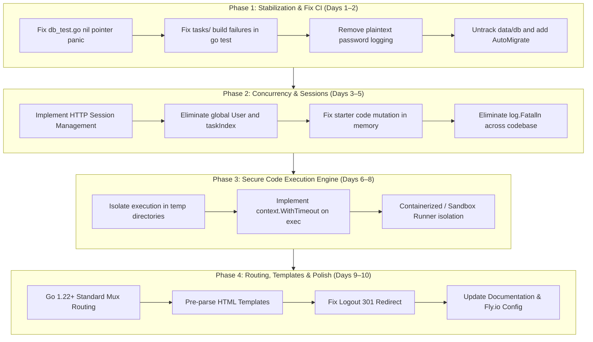

# Project Revival Assessment & Issue Tracker: Go-Solve

> **Status:** Assessment Complete & Revival Plan Formulated  
> **Repository:** `github.com/Carter907/go-solve`  
> **Assessment Date:** October 2026  
> **Go Version Target:** Go 1.24+  

---

## Executive Summary

`go-solve` is a web application inspired by CodingBat designed for practicing Golang programming challenges ("tasks"). The application is built using Go's standard library `net/http`, HTML templates, HTMX, Tailwind CSS, Ace Editor, GORM, and SQLite.

An assessment of the codebase reveals that while the core concept and HTMX frontend prototype are promising, the project is currently in a non-functional and vulnerable state. The test suite fails out-of-the-box (`go test ./...`), concurrent requests trigger severe data races, user sessions do not exist (causing all concurrent visitors to share one global identity), and user-submitted code is executed unsandboxed on the host machine.

This document serves as the canonical issue catalog and revival roadmap to transition `go-solve` from an unstable proof-of-concept into a secure, robust, and extensible web service.

---

## Issue Priority Matrix

| Issue ID | Priority | Category | Title | Severity | Status |
| :--- | :--- | :--- | :--- | :--- | :--- |
| **[SEC-01](#sec-01-arbitrary-remote-code-execution-rce-via-unsandboxed-runner)** | `P0` | Security | Arbitrary Remote Code Execution (RCE) via Unsandboxed Runner | Critical | Open (Phase 3) |
| **[SEC-02](#sec-02-denial-of-service-via-unbounded-execution-infinite-loops)** | `P0` | Security | Denial of Service via Unbounded Execution / Infinite Loops | Critical | **Resolved (Phase 1)** |
| **[SEC-03](#sec-03-cleartext-credential-logging-in-stdout)** | `P0` | Security | Cleartext Credential Logging in Application Output | High | **Resolved (Phase 1)** |
| **[ARCH-01](#arch-01-global-shared-state-and-absence-of-session-management)** | `P0` | Architecture | Global Shared State & Absence of Session Management | Critical | **Resolved (Phase 2)** |
| **[TEST-01](#test-01-broken-test-suite-and-failing-ci-builds)** | `P0` | Testing | Broken Test Suite & Failing CI Pipeline (`go test ./...`) | Critical | **Resolved (Phase 1)** |
| **[ARCH-02](#arch-02-file-clobbering-race-condition-in-code-execution)** | `P1` | Architecture | File Clobbering & Shared Disk State in Code Runner | High | **Resolved (Phase 1)** |
| **[ARCH-03](#arch-03-starter-code-mutation-in-shared-task-slice)** | `P1` | Architecture | Starter Code Mutation in Shared In-Memory Task Slice | High | **Resolved (Phase 2)** |
| **[ARCH-04](#arch-04-process-aborting-error-handling-logfatalln)** | `P1` | Reliability | Process-Aborting Error Handling (`log.Fatalln`) | High | **Resolved (Phase 1/2)** |
| **[DB-01](#db-01-tracked-sqlite-binary-with-personal-data)** | `P1` | Database | Tracked SQLite Database Binary with Developer Data | Medium | **Resolved (Phase 1)** |
| **[DB-02](#db-02-missing-schema-migrations-and-data-seeder)** | `P1` | Database | Missing Schema Migrations and Automated Data Seeding | High | **Resolved (Phase 1)** |
| **[DB-03](#db-03-hardcoded-database-path-and-missing-constraints)** | `P1` | Database | Hardcoded Relative DB Path and Missing Unique Constraints | Medium | **Resolved (Phase 1)** |
| **[WEB-01](#web-01-template-re-parsing-on-every-http-request)** | `P2` | Performance | Template Re-Parsing on Every HTTP Request | Medium | Open (Phase 4) |
| **[WEB-02](#web-02-brittle-manual-routing-and-index-based-task-lookup)** | `P2` | Architecture | Brittle Manual Routing and Index-Based Task Lookup | Medium | Open (Phase 4) |
| **[WEB-03](#web-03-permanent-redirect-caching-on-logout)** | `P2` | Bug | Permanent Redirect (HTTP 301) Caching on Logout | Medium | **Resolved (Phase 2)** |
| **[OPS-01](#ops-01-ephemeral-sqlite-storage-in-flyio-configuration)** | `P2` | DevOps | Ephemeral SQLite Storage in Fly.io Configuration | High | Open (Phase 4) |
| **[UI-01](#ui-01-cdn-dependence-and-uncompiled-tailwind-usage)** | `P3` | Frontend | CDN Dependence and Uncompiled Tailwind Development Bundle | Low | Open (Phase 4) |
| **[DOC-01](#doc-01-outdated-readme-and-placeholder-links)** | `P3` | Documentation| Outdated README and Placeholder Template Links | Low | Open (Phase 4) |

---

## Detailed Issue Specifications

### Critical Security & Concurrency (P0)

#### SEC-01: Arbitrary Remote Code Execution (RCE) via Unsandboxed Runner
- **Location:** `service/test_code.go` (`TestSolution`, `RunCode`)
- **Root Cause:** User code submitted from the browser editor is written directly to `./tasks/<difficulty>/<task>/solution.go` on the host machine and executed with `exec.Command("go", "test", path)`.
- **Impact:** An attacker can submit arbitrary Go code (e.g., using `os/exec`, `net`, `syscall`) to execute shell commands, read environment variables, destroy the filesystem, steal user databases, or pivot onto internal networks.
- **Remediation Plan:**
  1. Isolate test execution in a restricted environment:
     - Ephemeral container / Docker-out-of-Docker with `--network none`, read-only rootfs, dropped capabilities, and strict user namespaces.
     - Alternatively, utilize a sandboxing utility such as `nsjail` or `isolate`.
  2. Execute the runner under an unprivileged user with restricted filesystem access.
- **Acceptance Criteria:** Submitting malicious code (e.g., attempting to read `/etc/passwd` or run external bash commands) fails or returns an execution error without affecting the host server.

#### SEC-02: Denial of Service via Unbounded Execution / Infinite Loops
- **Location:** `service/test_code.go:58, 77`
- **Root Cause:** `exec.Command("go", "build", ...)` and `exec.Command("go", "test", ...)` are invoked without a `context.Context` timeout.
- **Impact:** Any user code containing an infinite loop (`for {}`) or long sleep (`time.Sleep(...)`) will hang the runner process indefinitely, consuming 100% CPU and blocking server execution threads.
- **Remediation Plan:**
  1. Replace `exec.Command` with `exec.CommandContext(ctx, ...)`.
  2. Enforce a hard timeout (e.g., 3–5 seconds) for compilation and testing.
  3. Ensure process group cleanup so child processes are killed on timeout.
- **Acceptance Criteria:** Submissions with infinite loops are terminated after the timeout period and return an informative "execution timed out" message.

#### SEC-03: Cleartext Credential Logging in Application Output
- **Location:** `handlers/handlers.go:172, 216`
- **Root Cause:** Passwords submitted via `/signup` and `/login` are printed directly to stdout via `fmt.Println`:
  - `fmt.Println("signing up as ", username, confirmPassword)`
  - `fmt.Println("logging in as", username, password)`
- **Impact:** Plaintext user passwords are leaked into stdout, console logs, system journals, and container logs.
- **Remediation Plan:** Remove `fmt.Println` statements referencing passwords and confirm passwords across all handlers.
- **Acceptance Criteria:** No user passwords appear in server output or logs during login or signup.

#### ARCH-01: Global Shared State and Absence of Session Management
- **Location:** `main.go:28-33`, `handlers/handlers.go:207-270`
- **Root Cause:**
  - A single `user := &model.User{}` pointer is instantiated once in `main.go` and shared across all HTTP handlers.
  - `LoginHandler` mutates this global `user` struct (`user.ID = userDB.ID`, `user.Username = userDB.Username`).
  - No HTTP cookies, session tokens, or JWTs exist.
  - `currTaskIndex := 0` is also passed as a shared pointer across all handlers.
- **Impact:**
  - When User A logs in, **every concurrent visitor** to the site immediately becomes authenticated as User A.
  - Logging out mutates the global struct for all visitors.
  - Concurrent requests create data races.
- **Remediation Plan:**
  1. Implement standard HTTP session management using signed HTTP-only cookies (e.g., using `gorilla/sessions` or standard library HMAC-signed session cookies).
  2. Maintain a database `sessions` table or cache storing `session_id -> user_id`.
  3. Remove global `user` and `currTaskIndex` variables from `main.go`. Each handler extracts the current user from the request context via auth middleware.
- **Acceptance Criteria:** Multiple distinct browser sessions maintain independent login states without cross-contamination.

#### TEST-01: Broken Test Suite and Failing CI Builds
- **Location:** `db/db_test.go:8`, `tasks/easy/bubbles/bubbles_test.go:13`, `tasks/easy/hello_world/hello_world_test.go:7`
- **Root Cause:**
  1. `db.TestGetAllTasks` dereferences `Conn` without calling `db.NewConnection()`, causing a SIGSEGV panic.
  2. `tasks/easy/bubbles` and `tasks/easy/hello_world` have test files that reference undefined functions (`Bubbles`, `ReturnMessage`) because no starter code or solution file is committed in those directories.
  3. GitHub Actions (`.github/workflows/go.yml`) runs `go test -v ./...` and fails.
- **Impact:** The repository cannot be verified with `go test ./...`. Continuous integration is permanently red.
- **Remediation Plan:**
  1. Fix `db_test.go` to initialize a test database (e.g., SQLite `:memory:` with automatic migrations).
  2. Add default starter stubs to task packages or restructure the runner so task directories are not treated as broken module packages during standard `go test ./...`.
  3. Expand `handlers_test.go` with actual assertions.
- **Acceptance Criteria:** `go test -v ./...` completes with exit code 0 across the entire repository.

---

### Core Architecture & Stability (P1)

#### ARCH-02: File Clobbering & Shared Disk State in Code Runner
- **Location:** `service/test_code.go:35`
- **Root Cause:** `os.Create(path + "/solution.go")` writes directly into the repository task source directory.
- **Impact:**
  - If two users submit code simultaneously, one submission overwrites the other during compilation.
  - Running tests dirties the local Git working tree with untracked/ignored `solution.go` files.
- **Remediation Plan:**
  1. Generate an isolated temporary directory per execution: `dir, err := os.MkdirTemp("", "gosolve-run-*")`.
  2. Copy task test files and write the user's `solution.go` into that temporary directory.
  3. Execute `go test` within the temporary directory.
  4. Ensure guaranteed cleanup via `defer os.RemoveAll(dir)`.
- **Acceptance Criteria:** Parallel code submissions execute independently without file collision or persistent artifacts on disk.

#### ARCH-03: Starter Code Mutation in Shared In-Memory Task Slice
- **Location:** `handlers/handlers.go:139` (`task.Code = editorContent`)
- **Root Cause:** `task` in `RunCodeHandler` points directly to an element of the global `tasks []model.Task` slice loaded once at startup.
- **Impact:** When a user modifies code in the editor and clicks "Run Code", the starter template stored in memory is permanently overwritten. Any subsequent user visiting that task will see the previous user's modified code instead of the starter code.
- **Remediation Plan:**
  - Treat task definitions as immutable.
  - User-specific code drafts should be tracked per-user (e.g., in `task_progress` or a `drafts` table) rather than mutating the catalog task struct.
- **Acceptance Criteria:** Running code on a task does not alter the starter code presented to other users or new sessions.

#### ARCH-04: Process-Aborting Error Handling (`log.Fatalln`)
- **Location:**
  - `service/service.go:59, 86, 100, 112, 121, 131`
  - `handlers/handlers.go:195, 201, 251, 257`
- **Root Cause:** Heavy use of `log.Fatalln(...)` inside handler and service logic on ordinary runtime errors (e.g. database errors, template parsing errors).
- **Impact:** Any transient database error or unexpected input crashes the entire web server with `os.Exit(1)`.
- **Remediation Plan:**
  1. Replace `log.Fatalln` with idiomatic Go error returns (`return nil, fmt.Errorf(...)`).
  2. Handle errors in HTTP handlers by rendering user-friendly error messages or HTTP 500 error responses.
  3. Use structured logging (`log/slog`).
- **Acceptance Criteria:** No request path can trigger process termination on error.

#### DB-01: Tracked SQLite Database Binary with Developer Data
- **Location:** `data/db`
- **Root Cause:** The actual SQLite database file `data/db` is tracked in Git, containing test users (`Carter907`, `Bingo`) and old data.
- **Impact:**
  - Git repository bloat and binary merge conflicts.
  - Exposure of developer test accounts and password hashes.
  - Risk of schema divergence between environments.
- **Remediation Plan:**
  1. Untrack `data/db` from Git (`git rm --cached data/db`).
  2. Add `data/*.db`, `data/*.sqlite*` to `.gitignore`.
  3. Implement automated migrations and seed scripts to build a fresh database on first run.
- **Acceptance Criteria:** Cloning the repo does not require a checked-in database binary; running the server initializes the database cleanly.

#### DB-02: Missing Schema Migrations and Automated Data Seeding
- **Location:** `db/db.go`, `main.go`
- **Root Cause:** `db.NewConnection()` connects to SQLite but never calls `Conn.AutoMigrate(...)` or executes schema creation scripts.
- **Impact:** If `data/db` does not already exist, the server fails with `no such table` errors when attempting queries.
- **Remediation Plan:**
  1. Add GORM `AutoMigrate` for `model.User`, `model.Task`, and `model.TaskProgress` inside database initialization.
  2. Provide a seed function that automatically populates default tasks if the `task` table is empty.
- **Acceptance Criteria:** Deleting `data/db` and starting the app automatically creates tables and seeds starter tasks without manual intervention.

#### DB-03: Hardcoded Relative DB Path and Missing Unique Constraints
- **Location:** `db/db.go:22`, SQLite table schemas
- **Root Cause:**
  1. `sqlite.Open("./data/db")` hardcodes the database path relative to CWD. Running from subpackages fails.
  2. SQLite schema lacks `UNIQUE` constraint on `user.username` and compound `UNIQUE(user_id, task_id)` on `task_progress`.
- **Remediation Plan:**
  1. Allow configuring the database path via environment variable `DATABASE_PATH` (defaulting to `./data/go-solve.db`).
  2. Add `gorm:"uniqueIndex"` tags to `User.Username` and `TaskProgress(UserID, TaskID)`.
  3. Enable SQLite foreign keys: `PRAGMA foreign_keys = ON;`.
- **Acceptance Criteria:** Running the application from any working directory works via config; duplicate usernames are prevented at the database layer.

---

### Web Routing, Reliability & UX (P2)

#### WEB-01: Template Re-Parsing on Every HTTP Request
- **Location:** `handlers/handlers.go:46, 55, 114, 193, 249`
- **Root Cause:** `template.ParseGlob` and `template.ParseFiles` are called synchronously inside HTTP handler invocations.
- **Impact:** Unnecessary disk I/O, CPU overhead, and memory churn on every HTTP request.
- **Remediation Plan:**
  1. Parse templates once at package or application startup into an immutable template registry.
  2. In development mode, allow optional re-parsing via a config flag for hot reloading.
- **Acceptance Criteria:** Handlers execute pre-parsed templates via `ExecuteTemplate` without disk reads during request handling.

#### WEB-02: Brittle Manual Routing and Index-Based Task Lookup
- **Location:** `main.go:35-63`, `handlers/handlers.go:16, 106`
- **Root Cause:**
  - Routing manually splits `r.URL.Path[1:]`.
  - `/editor` relies on `taskIndex` (an index into the in-memory slice) rather than a persistent `taskID`.
  - Missing bounds checks (`tasks[index]`) can trigger index-out-of-range panics.
- **Remediation Plan:**
  1. Use modern Go 1.22+ routing patterns: `GET /tasks/{id}`, `POST /tasks/{id}/run`, `GET /signup`, etc.
  2. Reference tasks by their permanent ID rather than transient slice indices.
- **Acceptance Criteria:** Tasks are accessible via clean URLs (`/tasks/1`), and invalid IDs return 404 Not Found without panicking.

#### WEB-03: Permanent Redirect (HTTP 301) Caching on Logout
- **Location:** `handlers/handlers.go:269`
- **Root Cause:** `LogoutHandler` uses `http.Redirect(w, r, "/", http.StatusMovedPermanently)`.
- **Impact:** Browsers permanently cache 301 redirects for `/logout`, preventing subsequent authentication actions until browser cache is manually cleared.
- **Remediation Plan:** Change status code to `http.StatusSeeOther` (303) or `http.StatusFound` (302).
- **Acceptance Criteria:** Logging out redirects with HTTP 303/302 and allows immediate re-login.

#### OPS-01: Ephemeral SQLite Storage in Fly.io Configuration
- **Location:** `fly.toml`
- **Root Cause:** `fly.toml` configures an ephemeral machine without a mounted volume for SQLite storage.
- **Impact:** Every deployment or machine stop/restart erases all registered users and task progress.
- **Remediation Plan:**
  1. Add a `[mounts]` section in `fly.toml` targeting `/data`.
  2. Update Dockerfile to ensure `/data` volume directory permissions.
- **Acceptance Criteria:** Fly.io configuration persists SQLite database across machine restarts.

---

### Polish & Developer Experience (P3)

#### UI-01: CDN Dependence and Uncompiled Tailwind Development Bundle
- **Location:** `templates/base.html:9, 13, 14`
- **Root Cause:** Uses `` which triggers browser warnings and lacks Subresource Integrity (SRI) hashes.
- **Remediation Plan:**
  1. Add a minimal Tailwind build step or bundle precompiled CSS in `static/css/`.
  2. Vendor or add SRI integrity hashes to Ace Editor and HTMX CDN scripts.
- **Acceptance Criteria:** Browser console is free of Tailwind production warnings; assets are securely loaded.

#### DOC-01: Outdated README and Placeholder Links
- **Location:** `README.md`
- **Root Cause:** README contains broken template placeholders (e.g. `[linkedin-url]: https://linkedin.com/in/othneildrew`) and obsolete roadmap items.
- **Remediation Plan:**
  1. Update `README.md` with accurate architectural overview, prerequisites, and setup instructions.
  2. Link directly to `ISSUES.md` for project roadmap and issue tracking.
- **Acceptance Criteria:** README contains zero template placeholder links and provides a clear guide for local development.

---

## Phased Revival Roadmap

---

## Immediate Next Steps

To begin reviving the codebase immediately, execute the following actions in order:
1. **Fix `db_test.go`**: Initialize in-memory SQLite and run `AutoMigrate` so `TestGetAllTasks` passes.
2. **Fix `tasks/` package tests**: Provide starter stubs or separate runner packages so `go test ./...` passes.
3. **Purge sensitive logs**: Remove password printing in `handlers.go`.
4. **Untrack `data/db`**: Run `git rm --cached data/db` and add automated schema seeding.
5. **Implement Session Auth**: Replace global `*model.User` with session cookies and request context.
