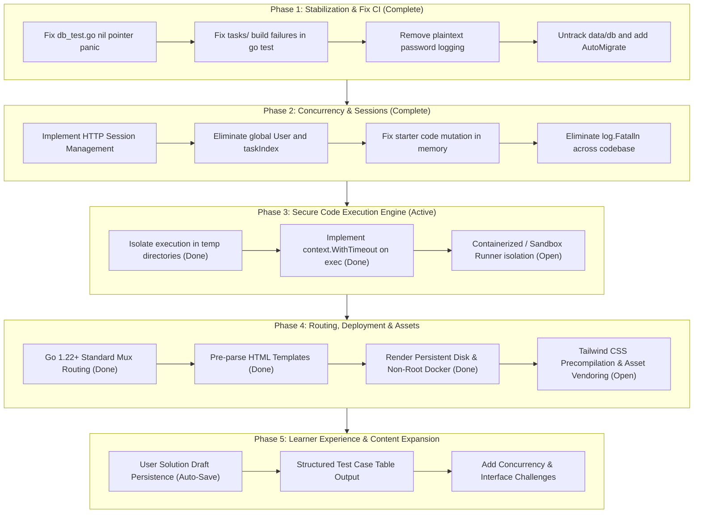

# Project Revival Assessment & Issue Tracker: Go-Solve

> **Status:** Phases 1 & 2 Complete; Phase 4 Routing & Templates Complete; Phase 3 Sandboxing & Next-Gen Polish Active  
> **Repository:** `github.com/Carter907/go-solve`  
> **Assessment Date:** October 2026  
> **Go Version Target:** Go 1.24+  

---

## Executive Summary

`go-solve` is an open-source, web-based programming practice platform for the Go language (inspired by CodingBat). Learners solve algorithmic challenges ("tasks") directly in an in-browser code editor (Ace Editor), run their code against test suites in real-time using HTMX, and track their progress across difficulty tiers.

The repository has undergone significant stabilization and architectural modernization:
- **CI & Test Suite:** 100% green across all packages (`go test ./...`) with unit, integration, and reference solution verification.
- **Session Auth & State Isolation:** Replaced global shared user and index pointers with secure, cryptographically random cookie session tokens and isolated database sessions.
- **Routing & Rendering:** Upgraded to Go 1.22+ standard HTTP mux routing (`/problems/{id}` using `r.PathValue`), pre-parsed template registries (`TemplateRegistry`), and categorized module navigation on the homepage.
- **Runner Reliability:** Ephemeral execution in `os.MkdirTemp` directories with hard 5-second `context.WithTimeout` process cancellation.

The primary remaining critical vulnerability is **SEC-01** (remote code execution via unsandboxed runner on the host/container), accompanied by operational persistence requirements (**OPS-01**), draft persistence (**FEAT-01**), and test feedback enhancements (**FEAT-02**).

---

## Issue Priority Matrix

| Issue ID | Priority | Category | Title | Severity | Status |
| :--- | :--- | :--- | :--- | :--- | :--- |
| **[SEC-01](#sec-01-arbitrary-remote-code-execution-rce-via-unsandboxed-runner)** | `P0` | Security | Arbitrary Remote Code Execution (RCE) via Unsandboxed Runner | Critical | **Open (Phase 3)** |
| **[SEC-02](#sec-02-denial-of-service-via-unbounded-execution-infinite-loops)** | `P0` | Security | Denial of Service via Unbounded Execution / Infinite Loops | Critical | **Resolved (Phase 1)** |
| **[SEC-03](#sec-03-cleartext-credential-logging-in-stdout)** | `P0` | Security | Cleartext Credential Logging in Application Output | High | **Resolved (Phase 1)** |
| **[ARCH-01](#arch-01-global-shared-state-and-absence-of-session-management)** | `P0` | Architecture | Global Shared State & Absence of Session Management | Critical | **Resolved (Phase 2)** |
| **[TEST-01](#test-01-broken-test-suite-and-failing-ci-builds)** | `P0` | Testing | Broken Test Suite & Failing CI Pipeline (`go test ./...`) | Critical | **Resolved (Phase 1)** |
| **[ARCH-02](#arch-02-file-clobbering-race-condition-in-code-execution)** | `P1` | Architecture | File Clobbering & Shared Disk State in Code Runner | High | **Resolved (Phase 1)** |
| **[ARCH-03](#arch-03-starter-code-mutation-in-shared-task-slice)** | `P1` | Architecture | Starter Code Mutation in Shared In-Memory Task Slice | High | **Resolved (Phase 2)** |
| **[ARCH-04](#arch-04-process-aborting-error-handling-logfatalln)** | `P1` | Reliability | Process-Aborting Error Handling (`log.Fatalln`) | High | **Resolved (Phase 1/2)** |
| **[DB-01](#db-01-tracked-sqlite-binary-with-personal-data)** | `P1` | Database | Tracked SQLite Database Binary with Developer Data | Medium | **Resolved (Phase 1)** |
| **[DB-02](#db-02-missing-schema-migrations-and-data-seeder)** | `P1` | Database | Missing Schema Migrations and Automated Data Seeding | High | **Resolved (Phase 1)** |
| **[DB-03](#db-03-hardcoded-database-path-and-missing-constraints)** | `P1` | Database | Hardcoded Relative DB Path and Missing Unique Constraints | Medium | **Resolved (Phase 1)** |
| **[FEAT-01](#feat-01-user-solution-draft-persistence-auto-save)** | `P1` | Feature/UX | User Solution Draft Persistence (Auto-Save) | Medium | **Open (Phase 5)** |
| **[WEB-01](#web-01-template-re-parsing-on-every-http-request)** | `P2` | Performance | Template Re-Parsing on Every HTTP Request | Medium | **Resolved (Phase 4)** |
| **[WEB-02](#web-02-brittle-manual-routing-and-index-based-task-lookup)** | `P2` | Architecture | Brittle Manual Routing and Index-Based Task Lookup | Medium | **Resolved (Phase 4)** |
| **[WEB-03](#web-03-permanent-redirect-caching-on-logout)** | `P2` | Bug | Permanent Redirect (HTTP 301) Caching on Logout | Medium | **Resolved (Phase 2)** |
| **[OPS-01](#ops-01-ephemeral-sqlite-storage-in-render-deployment-configuration)** | `P2` | DevOps | Ephemeral SQLite Storage in Render Deployment Configuration | High | **Resolved (Phase 4)** |
| **[SEC-04](#sec-04-container-security-and-non-root-docker-execution)** | `P2` | Security | Container Security & Non-Root Docker Execution | Medium | **Resolved (Phase 4)** |
| **[FEAT-02](#feat-02-structured-grader-test-case-output-diff)** | `P2` | Feature/UX | Structured Grader Test Case Output (Diff / Table View) | Medium | **Open (Phase 5)** |
| **[CONT-01](#cont-01-task-catalog-expansion-concurrency-and-idiomatic-go)** | `P2` | Content | Task Catalog Expansion: Concurrency, Channels & Interfaces | Medium | **Open (Phase 5)** |
| **[UI-01](#ui-01-cdn-dependence-and-uncompiled-tailwind-usage)** | `P3` | Frontend | CDN Dependence and Uncompiled Tailwind Development Bundle | Low | **Open (Phase 4)** |
| **[DOC-01](#doc-01-outdated-readme-and-placeholder-links)** | `P3` | Documentation| Outdated README and Placeholder Template Links | Low | **Resolved (Phase 4)** |

---

## Detailed Issue Specifications

### Critical Security & Concurrency (P0)

#### SEC-01: Arbitrary Remote Code Execution (RCE) via Unsandboxed Runner
- **Location:** `service/test_code.go` (`TestSolution`, `RunCode`)
- **Status:** **Open (Phase 3 Active)**
- **Root Cause:** User code submitted from the browser editor is executed via `exec.CommandContext(ctx, "go", "test", "-v", ".")` on the host/container operating system under the server process's identity.
- **Impact:** While executed in an ephemeral directory with a 5-second timeout, malicious submissions can still import `os/exec`, `net`, `syscall`, access filesystem secrets, tamper with databases, or pivot to local network interfaces.
- **Remediation Plan:**
  1. Isolate test execution in a restricted sandbox:
     - Ephemeral container runner or unprivileged worker daemon with `--network none`, read-only rootfs, and dropped capabilities (`CAP_DROP=ALL`).
     - Or utilize a low-overhead Linux sandboxing tool (`nsjail`, `isolate`, or Linux user namespaces/seccomp filters).
  2. Execute the runner under an unprivileged user (`nobody` / `appuser`) with strict memory (`setrlimit`) and CPU caps.
- **Acceptance Criteria:** Submitting malicious code (e.g., attempting to read `/etc/shadow`, query local metadata endpoints, or fork bomb) fails or is blocked without impacting the host web server.

#### SEC-02: Denial of Service via Unbounded Execution / Infinite Loops
- **Location:** `service/test_code.go`
- **Status:** **Resolved (Phase 1)**
- **Resolution:** `exec.CommandContext(ctx, "go", "test", "-v", ".")` with a 5-second `context.WithTimeout` terminates any run that hangs on infinite loops (`for {}`) or sleeps, returning a descriptive timeout error.

#### SEC-03: Cleartext Credential Logging in Application Output
- **Location:** `handlers/handlers.go`
- **Status:** **Resolved (Phase 1)**
- **Resolution:** Removed all `fmt.Println` logging calls printing plaintext passwords or user inputs during `/signup` and `/login`.

#### ARCH-01: Global Shared State and Absence of Session Management
- **Location:** `main.go`, `handlers/handlers.go`, `service/service.go`
- **Status:** **Resolved (Phase 2)**
- **Resolution:** Removed global shared `*model.User` and index pointers. Implemented cryptographically secure 32-byte hex session tokens stored in the SQLite `session` table and transmitted via HTTP-only, `SameSite=Lax` cookies.

#### TEST-01: Broken Test Suite and Failing CI Builds
- **Location:** `db/db_test.go`, `tasks/easy/`
- **Status:** **Resolved (Phase 1)**
- **Resolution:** Replaced broken nil-pointer DB references with an in-memory SQLite test suite (`:memory:`), added working reference solutions to all task packages, and established a fully green CI pipeline.

---

### Core Architecture & Stability (P1)

#### ARCH-02: File Clobbering & Shared Disk State in Code Runner
- **Location:** `service/test_code.go`
- **Status:** **Resolved (Phase 1)**
- **Resolution:** Replaced shared host directory writing with ephemeral temporary directories (`os.MkdirTemp("", "gosolve-eval-*")`) and guaranteed cleanup (`defer os.RemoveAll(tmpDir)`).

#### ARCH-03: Starter Code Mutation in Shared In-Memory Task Slice
- **Location:** `handlers/handlers.go`
- **Status:** **Resolved (Phase 2)**
- **Resolution:** Handlers now clone task structs prior to evaluation (`evalTask := *task`), preventing user edits in the browser editor from mutating in-memory starter stubs.

#### ARCH-04: Process-Aborting Error Handling (`log.Fatalln`)
- **Location:** `service/service.go`, `handlers/handlers.go`
- **Status:** **Resolved (Phase 1/2)**
- **Resolution:** Replaced all runtime `log.Fatalln` calls with idiomatic Go error returns (`return nil, fmt.Errorf(...)`) and standard sentinel errors (`ErrUserNotFound`, `ErrInvalidCredentials`, etc.).

#### DB-01: Tracked SQLite Database Binary with Developer Data
- **Location:** `data/db`
- **Status:** **Resolved (Phase 1)**
- **Resolution:** Untracked `data/db` from Git, added local database patterns to `.gitignore`, and purged test credentials from repository history.

#### DB-02: Missing Schema Migrations and Automated Data Seeding
- **Location:** `db/db.go`, `db/seed.go`, `main.go`
- **Status:** **Resolved (Phase 1)**
- **Resolution:** Added automatic schema migrations on startup for `User`, `Task`, `TaskProgress`, and `Session`, along with idempotent seeding of default tasks.

#### DB-03: Hardcoded Relative DB Path and Missing Unique Constraints
- **Location:** `db/db.go`, `model/user.go`, `model/task_progress.go`
- **Status:** **Resolved (Phase 1)**
- **Resolution:** Added `DATABASE_PATH` environment variable configuration (defaulting to `./data/go-solve.db`), added unique constraint indices to `User.Username` and `TaskProgress(UserID, TaskID)`, and enabled SQLite foreign keys.

#### FEAT-01: User Solution Draft Persistence (Auto-Save)
- **Location:** `model/task_progress.go`, `handlers/handlers.go`, `templates/editor.html`
- **Status:** **Open (Phase 5)**
- **Root Cause:** When an authenticated user edits code in the Ace Editor and navigates away or refreshes the browser, unsaved changes are lost and revert to the task's starter code.
- **Remediation Plan:**
  1. Add `DraftCode string` to `model.TaskProgress`.
  2. Update `ProblemHandler` to load the user's persisted draft if one exists, falling back to starter `task.Code`.
  3. Automatically persist draft code on submission (`/run-code`) and provide an auto-save endpoint or periodic HTMX save.
  4. Provide a "Reset to Starter Code" action in the editor toolbar.
- **Acceptance Criteria:** A user can edit code, refresh or switch tasks, and return to find their previous draft intact.

---

### Web Routing, Reliability & UX (P2)

#### WEB-01: Template Re-Parsing on Every HTTP Request
- **Location:** `handlers/templates.go`, `handlers/handlers.go`
- **Status:** **Resolved (Phase 4)**
- **Resolution:** Introduced a thread-safe `TemplateRegistry` initialized once at startup with specialized view-model rendering methods.

#### WEB-02: Brittle Manual Routing and Index-Based Task Lookup
- **Location:** `main.go`, `handlers/handlers.go`
- **Status:** **Resolved (Phase 4)**
- **Resolution:** Adopted Go 1.22+ mux routing patterns (`/problems/{id}`) using `r.PathValue("id")`. Lookups query the database directly by task ID and return 404 for nonexistent tasks without panics.

#### WEB-03: Permanent Redirect (HTTP 301) Caching on Logout
- **Location:** `handlers/handlers.go`
- **Status:** **Resolved (Phase 2)**
- **Resolution:** Replaced `http.StatusMovedPermanently` (301) with `http.StatusSeeOther` (303) to prevent browser caching of logout redirects.

#### OPS-01: Ephemeral SQLite Storage in Render Deployment Configuration
- **Location:** `render.yaml`
- **Status:** **Resolved (Phase 4)**
- **Resolution:** Provided declarative `render.yaml` blueprint defining persistent disk mount (`/data`), configured `DATABASE_PATH=/data/go-solve.db`, and ensured directories are provisioned with proper user permissions for persistence across redeploys.

#### SEC-04: Container Security and Non-Root Docker Execution
- **Location:** `Dockerfile`, `.github/workflows/go.yml`
- **Status:** **Resolved (Phase 4)**
- **Resolution:** Hardened `Dockerfile` by creating an unprivileged system user (`appuser:appgroup`, UID/GID 10001), restricted `/app` to read-only, pre-warmed Go test cache under `appuser`, switched execution to `USER appuser`, and added CI verification in GitHub Actions.

#### FEAT-02: Structured Grader Test Case Output (Diff / Table View)
- **Location:** `service/test_code.go`, `templates/editor.html`
- **Status:** **Open (Phase 5)**
- **Root Cause:** The test runner returns raw CLI output chunks from `go test -v .`. Learners must read through terminal failure strings rather than an intuitive test case table.
- **Remediation Plan:**
  1. Parse standard `go test -json` or format test outputs into structured test cases: `Name`, `Input`, `Expected`, `Actual`, and `Status (PASS/FAIL)`.
  2. Update the HTMX `#output` fragment in `templates/editor.html` to render an intuitive test results table (CodingBat/LeetCode style).
- **Acceptance Criteria:** Users see a table of individual test cases showing inputs, expected vs. received outputs, and clear pass/fail badges.

#### CONT-01: Task Catalog Expansion: Concurrency, Channels & Interfaces
- **Location:** `tasks/`, `db/seed.go`
- **Status:** **Open (Phase 5)**
- **Root Cause:** The catalog currently only contains 7 starter tasks (mostly easy string/slice exercises). Core strengths of Go (goroutines, channels, mutexes, interfaces, standard library idioms) are not yet represented.
- **Remediation Plan:**
  1. Add concurrency tasks: worker pools, buffered channel pipelines, `sync.WaitGroup` synchronization.
  2. Add interface tasks: custom `io.Reader` implementations, error wrapping with `errors.Is`/`errors.As`.
  3. Add intermediate algorithms: binary search, LRU cache, and tree traversals.
- **Acceptance Criteria:** At least 15 comprehensive tasks spanning Basics, Strings, Slices & Sorting, Maps & Structs, and Concurrency.

---

### Polish & Developer Experience (P3)

#### UI-01: CDN Dependence and Uncompiled Tailwind Development Bundle
- **Location:** `templates/base.html`, `static/`
- **Status:** **Open (Phase 4)**
- **Root Cause:** Uses `` which triggers browser warnings in production and lacks Subresource Integrity (SRI) hashes.
- **Remediation Plan:**
  1. Generate a precompiled Tailwind CSS bundle in `static/css/styles.css`.
  2. Vendor or add SRI integrity hashes to Ace Editor and HTMX script tags.
- **Acceptance Criteria:** Browser console is free of Tailwind production warnings; all external CDN scripts have SRI integrity checks or are served locally.

#### DOC-01: Outdated README and Placeholder Links
- **Location:** `README.md`
- **Status:** **Resolved (Phase 4)**
- **Resolution:** Completely rewrote `README.md` with accurate architectural flow, quickstart instructions, module catalog, and verified contribution guides.

---

## Phased Revival Roadmap

---

## Immediate Next Steps

1. **Implement SEC-01 (Secure Runner Sandboxing):** Introduce process sandboxing (`nsjail`, unprivileged user isolation, or container-based runner) to prevent arbitrary host RCE.
2. **Implement FEAT-01 (Solution Draft Auto-Save):** Add draft persistence to `model.TaskProgress` so learners don't lose uncommitted code.
3. **Implement UI-01 (Tailwind & Asset Bundling):** Precompile Tailwind CSS and add SRI hashes / local vendoring for editor assets.
4. **Implement FEAT-02 (Structured Grader Feedback):** Parse test outputs into test case tables showing inputs, expected vs actual values, and pass/fail badges.
5. **Implement CONT-01 (Expand Problem Catalog):** Introduce concurrency, channels, and intermediate Go challenges.
