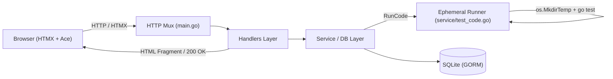

# Go-Solve 🚀

[](https://golang.org)
[](LICENSE)
[](https://htmx.org)
[](https://tailwindcss.com)

**Go-Solve** is an open-source, web-based programming practice platform for the Go programming language (inspired by CodingBat). Learners solve algorithmic challenges directly in an in-browser code editor, execute their code against real-time unit test suites using HTMX, and track their progress across difficulty tiers.

---

## 🌟 Key Features

- **Interactive In-Browser Editor:** Self-hosted Ace Editor with Go syntax highlighting and dark Gruvbox styling.
- **Isolated Code Execution:** User code is compiled and tested inside ephemeral directories with hard execution timeouts to terminate infinite loops.
- **Progress Tracking & User Accounts:** Secure password authentication using `bcrypt` (cost 14) and 30-day session cookies to preserve progress across visits. Anonymous practice is fully supported.
- **Categorized Problem Catalog:** Challenges grouped by concept: *Basics*, *Strings*, *Slices & Sorting*, and *Maps & Structs*.
- **Pre-Parsed Template Registry:** Fast server-side HTML rendering (`html/template`) compiled on application startup with zero disk reads on request paths.
- **Zero Heavy Frontend Frameworks:** Dynamic UI swaps powered entirely by HTMX without heavy client-side JavaScript bundles.

---

## 🏗️ Architecture



---

## 🚀 Quickstart

### Prerequisites
- [Go 1.24+](https://go.dev/dl/) installed (`go version`)
- Git

### Running Locally
```sh
# 1. Clone repository
git clone https://github.com/Carter907/go-solve.git
cd go-solve

# 2. Start the server (auto-migrates SQLite and seeds default challenges)
go run main.go

# 3. Open in browser
open http://localhost:8080
```

### Configuration
Configure the application using environment variables:

| Variable | Default | Description |
| :--- | :--- | :--- |
| `PORT` | `8080` | TCP port for the HTTP server |
| `DATABASE_PATH` | `./data/go-solve.db` | Local path for the SQLite database |

---

## 🧪 Testing

Always verify the full test suite before submitting pull requests:

```sh
# Run all tests across all packages
go test -v ./...

# Run tests with race detection
go test -race ./...
```

---

## 📁 Repository Layout

```
.
├── db/              # Database connection, GORM auto-migrations, and seed catalog
├── handlers/        # HTTP handlers, session extraction, and TemplateRegistry
├── model/           # Data models (User, Task, Session, TaskProgress)
├── security/        # Bcrypt password hashing and verification
├── service/         # Domain business logic and ephemeral code execution runner
├── static/          # Static assets (favicons, self-hosted Ace Editor bundle)
├── tasks/           # Problem catalog test suites & reference solutions
│   ├── easy/        # Easy problems (bubbles, find_maximum, hello_world, etc.)
│   └── medium/      # Medium problems (word_count)
├── templates/       # HTML templates (base layout, pages, and HTMX partials)
├── Dockerfile       # Production container specification
├── ISSUES.md        # Comprehensive revival assessment and issue tracker
├── AGENTS.md        # Developer and AI agent operational guide
└── main.go          # Server entrypoint and routing
```

---

## 🗺️ Roadmap & Revival Status

Consult [`ISSUES.md`](ISSUES.md) for the active backlog and priority matrix.

- [x] **Phase 1: Stabilization & Fix CI** (Repaired test suite, reference solutions, runner timeout, AutoMigrate & seeder, untracked SQLite binary).
- [x] **Phase 2: Concurrency & Sessions** (Cookie session management, eliminated global shared user state, task ID routing, starter code immutability).
- [x] **Phase 4 (Partial): Template Registry & View Models** (Pre-parsed templates, decoupled view models, layout composition).
- [ ] **Phase 3: Secure Runner Sandboxing** (Containerized execution with dropped capabilities / gVisor / nsjail to prevent arbitrary host RCE).
- [ ] **Phase 4: Routing & Performance Polish** (Go 1.22+ mux routing patterns, Render persistent disk, non-root Docker execution).

---

## 🤝 Contributing

Contributions are welcome! Please check out [`AGENTS.md`](AGENTS.md) and [`ISSUES.md`](ISSUES.md) before submitting pull requests.

1. Fork the Project
2. Create your Feature Branch (`git checkout -b feat/amazing-feature`)
3. Commit your Changes using Conventional Commits (`git commit -m 'feat: add amazing feature'`)
4. Push to the Branch (`git push origin feat/amazing-feature`)
5. Open a Pull Request

---

## 📄 License

Distributed under the GNU General Public License v3.0 (GPL-3.0). See [`LICENSE`](LICENSE) for more information.
